<div align="center">

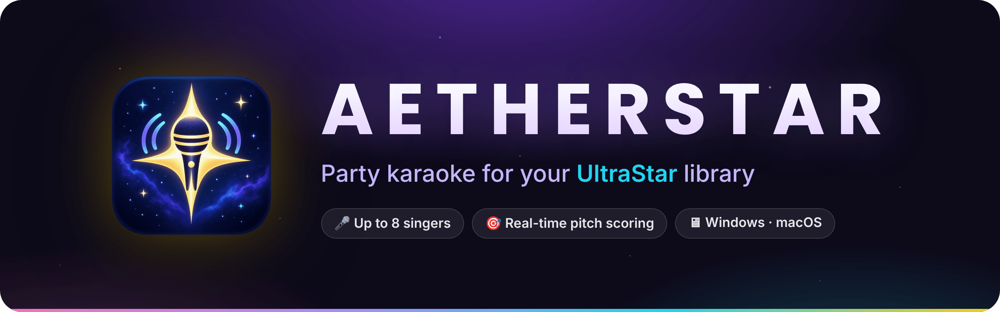

<br>

[](https://github.com/D3FXgit/AetherStar/releases)
[](https://github.com/D3FXgit/AetherStar/actions/workflows/ci.yml)
[](./LICENSE)

<br>


**A modern karaoke singing game for Windows and macOS. Plays your existing UltraStar song library.**

[**Download**](#download-and-install) · [Quick start](./docs/quick-start.md) · [Features](#features) · [Song library](#song-library) · [Build from source](#building-from-source) · [Troubleshooting](./docs/troubleshooting.md)

<br>

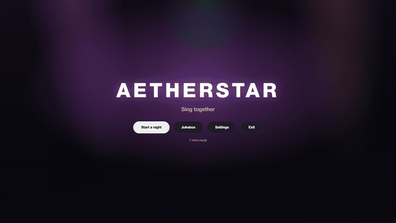

</div>

<br>

AetherStar is a party karaoke game for the desktop. Point it at a folder of UltraStar songs, plug in
one or more microphones, and up to eight people can sing at once while the app follows their pitch
and scores them. It runs on Electron and React, with pitch detection written in Rust.

Release builds are available for Windows and for macOS on Apple Silicon.

<a id="features"></a>

## ✨ Features

<table>
<tr>
<td width="50%" valign="top">

### 🎵 Your library, as it is
- Plays UltraStar `.txt` song libraries, including **duets**, **video backgrounds** and separate
  **vocal and instrumental stems**.
- Automatic **loudness matching** so every song plays at about the same volume, plus a volume mixer
  in Settings.
- Highscores per song, and a player roster with names, colours and photos.

</td>
<td width="50%" valign="top">

### 🎤 Built for a full room
- **Up to eight singers** at once, on separate USB mics or on the channels of one audio interface.
- Modes: **Solo/Duet**, **Versus**, and **Party** (the app draws singers and offers songs at random,
  favouring whoever has sung least).
- A second **audience window** for another monitor or a TV, with the lyrics and a live scoreboard.

</td>
</tr>
<tr>
<td width="50%" valign="top">

### 🎯 Fair, SingStar-style scoring
- Up to **10,000 points** per song, a **Perfect, Great or Good** rating for each line, and a final
  rank from **Tone Deaf** up to **Superstar**.
- Difficulty per singer, chosen when you assign singers: **Easy, Normal or Hard** (within 2, 1 or 0
  semitones of the note). Singing in any octave counts.
- Notes are shown one line at a time, with a playhead that sweeps across the line.

</td>
<td width="50%" valign="top">

### 🛠 Set up once, play all night
- A **calibration wizard** that measures speaker and microphone delay, so scoring stays fair on slow
  Bluetooth or USB audio.
- Works with **keyboard, mouse and gamepad**.
- A **Jukebox** mode with a transport bar and an editable "Up next" queue.

</td>
</tr>
</table>

## 📸 Screenshots

<table>
<tr>
<td width="50%">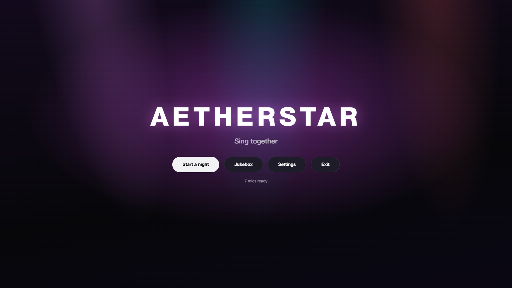<p align="center"><sub><b>Home</b> · start a night, open the jukebox or settings</sub></p></td>
<td width="50%">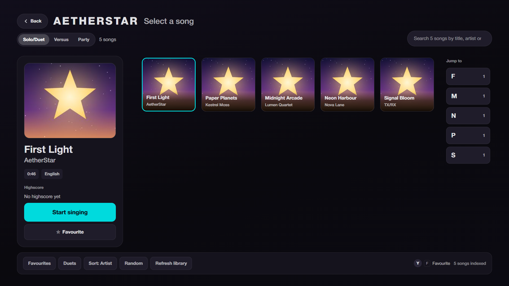<p align="center"><sub><b>Song select</b> · search, jump-to letters, favourites and duets</sub></p></td>
</tr>
<tr>
<td width="50%">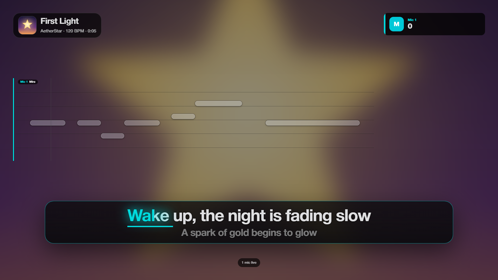<p align="center"><sub><b>Singing</b> · line-paged notes, live lyrics, per-mic score</sub></p></td>
<td width="50%">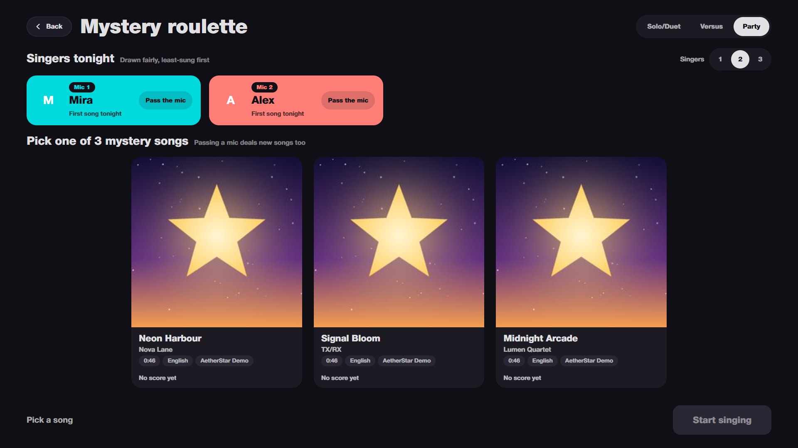<p align="center"><sub><b>Party</b> · singers drawn fairly, pick one of three mystery songs</sub></p></td>
</tr>
<tr>
<td width="50%">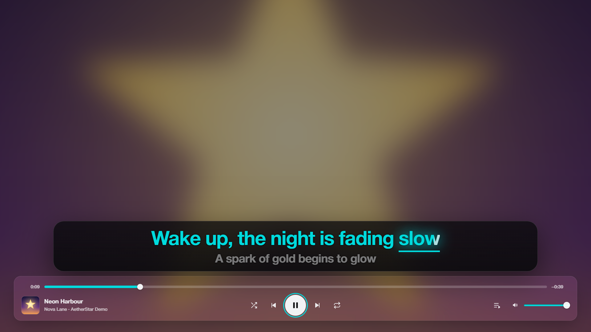<p align="center"><sub><b>Jukebox</b> · lyrics on screen, shuffle, repeat and a queue</sub></p></td>
<td width="50%">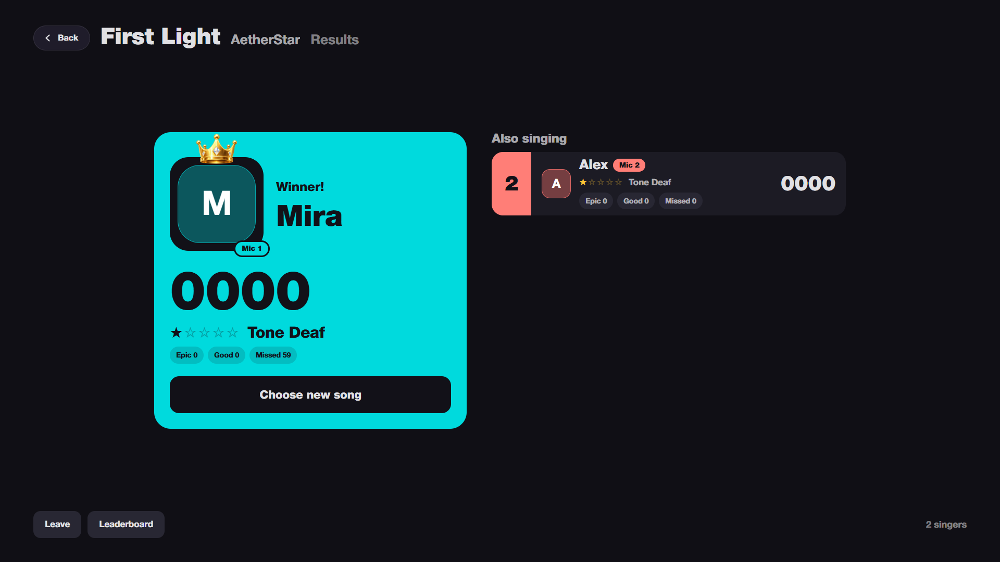<p align="center"><sub><b>Results</b> · winner, rank and per-line rating counts</sub></p></td>
</tr>
</table>

<div align="center">
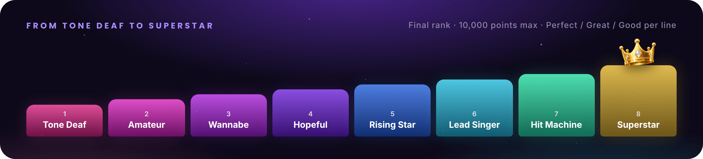
</div>

<a id="download-and-install"></a>

## 📥 Download and install

Download the installer for your system from the
[**Releases page**](https://github.com/D3FXgit/AetherStar/releases).

| System | File |
| --- | --- |
| Windows 10/11 (x64) | `AetherStar-<version>-win-x64.exe` |
| macOS (Apple Silicon) | `AetherStar-<version>-mac-arm64.dmg` (or `.zip`) |

The release builds are not code-signed, so your system will warn you the first time:

- **Windows SmartScreen:** choose **More info**, then **Run anyway**.
- **macOS Gatekeeper:** right-click the app in Applications and choose **Open**, then **Open** again.
  If macOS still blocks it, go to **System Settings > Privacy & Security** and choose
  **Open Anyway**.

Then follow the [Quick start](./docs/quick-start.md) to add songs, set up microphones and sing.

<a id="song-library"></a>

## 📂 Setting up a song library

AetherStar does not ship with songs. You need your own UltraStar songs, one folder per song:

```
Songs/
  Artist - Title/
    Artist - Title.txt        the chart: tags, then notes and lyrics
    Artist - Title.mp3        the audio
    Artist - Title.mp4        optional video
    Artist - Title [CO].jpg   optional cover art
```

Add the top folder in **Settings > Song Folders**. The app scans it, including subfolders, and
remembers it. Use **Rescan** after you add or change songs. You can add more than one folder.

<details>
<summary><b>Tags the app reads from the <code>.txt</code> file</b></summary>
<br>

| Tag | Use |
| --- | --- |
| `#TITLE`, `#ARTIST` | Song name and artist |
| `#MP3` or `#AUDIO` | Audio file. `#AUDIO` wins if both are present. |
| `#BPM`, `#GAP` | Tempo, and the delay in milliseconds before the first note |
| `#VIDEO`, `#VIDEOGAP` | Background video, and its offset in seconds |
| `#COVER` | Cover image |
| `#START`, `#END` | Start or stop playback part-way through the song |
| `#PREVIEWSTART` | Where the preview starts in the song list |
| `#VOCALS`, `#INSTRUMENTAL` | Optional separate stems |
| `#VOLUME` | Per-song volume trim |
| `#LANGUAGE`, `#EDITION` | Stored with the song. Edition is searchable. |
| `#RELATIVE` | Charts where note timing restarts on every line |
| `#ENCODING` | Text encoding hint for older files |

</details>

File paths in tags are relative to the song's own folder. Charts can be UTF-8 or an older Windows
encoding (CP1252 is the default guess). Duets use `P1` and `P2` sections, and each part goes to a
different singer. A third part is folded into `P2`.

> [!NOTE]
> Videos that the app can't decode (old MPEG-2 `.mpg` files, for example) fall back to the cover art.
> Songs that can't be played at all, such as ones with a missing audio file, are marked in the song
> list instead of stopping the scan.

## ⚙️ How it works

<div align="center">
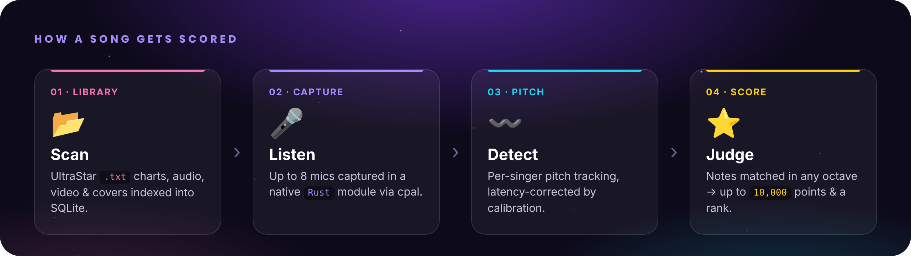
</div>

<a id="building-from-source"></a>

## 🧱 Building from source

### Requirements

- **Node.js 22.12+** and npm.
- A **Rust toolchain** (stable, from [rustup.rs](https://rustup.rs)). Microphone capture and pitch
  detection are a native module in `native/`, built with napi-rs.
- macOS or Windows:
  - **macOS:** Xcode Command Line Tools.
  - **Windows:** Visual Studio Build Tools with the "Desktop development with C++" workload. Rust and
    the SQLite module both need it.

> [!IMPORTANT]
> The setup scripts use `mkdir -p` and `cp`. On Windows, run npm from Git Bash, or set npm's
> script shell to it: `npm config set script-shell "C:\Program Files\Git\bin\bash.exe"`.

### Development

```bash
npm install
npm run dev
```

`npm run dev` builds the native module, rebuilds the SQLite module for Electron, starts the Vite dev
server on port 5173, and opens the app. Changes under `src/` reload right away. Changes under
`electron/` or `native/` need a restart of `npm run dev`.

| Script | What it does |
| --- | --- |
| `npm run dev` | Dev server and Electron, with hot reload and DevTools |
| `npm run dev:renderer` | Dev server only: the UI in a normal browser, without mics or file access |
| `npm run build` | Builds the UI into `dist/` |
| `npm start` | Builds, then runs Electron on the built files |
| `npm test` | Runs the Vitest suite |
| `npm run typecheck` | TypeScript check (`tsc --noEmit`) |
| `npm run lint` | ESLint |
| `npm run build:native` | Builds only the Rust module |
| `npm run package` | Unpacked app in `release/`, for a quick check |
| `npm run dist` | Installers for the current OS in `release/` |
| `npm run dist:mac` / `npm run dist:win` / `npm run dist:linux` | Installers for one platform |

The native module is built before `dev`, `start`, `package` and `dist`. The SQLite module is rebuilt
for Electron, and then again for plain Node so `npm test` keeps working. `npm test` checks this
before it runs.

macOS builds are signed and notarized only when `CSC_LINK`, `APPLE_ID`,
`APPLE_APP_SPECIFIC_PASSWORD` and `APPLE_TEAM_ID` are set. Without them, `dist:mac` prints a warning
and builds an unsigned app.

<details>
<summary><b>Project layout</b></summary>
<br>

```
electron/        Main process: windows, preload, media protocol, and the
                 library, players, audio, calibration and session back ends
native/          Rust module: audio capture (cpal) and pitch detection
src/
  scenes/        Boot, Home and the scene router
  session/       Song select, singer assignment, party draw, results, leaderboard
  game/          Gameplay: note lanes, pitch matching, scoring, HUD
  stage/         Song playback, lyrics, countdown, timing
  library/       Library scanning UI, browsing and search
  multiplayer/   Mic slots and multi-singer gameplay
  audio/         Mic check, devices, menu music, sound effects, loudness
  calibration/   Latency and difficulty wizard
  audience/      The second-screen window
  players/       Player roster and avatars
  settings/      Settings screen
  design/        Shared UI parts and design tokens
  input/         Keyboard and gamepad navigation
  lab/           Dev Lab test screens (development builds only)
assets/          Sound effects and UI images
menu_music/      Menu background music
fixtures/        Test charts and recorded pitch traces
build/           App icons for packaging
docs/            User docs
```

</details>

## 🔒 Security

- Every window runs with `contextIsolation: true`, `nodeIntegration: false` and `sandbox: true`.
- The UI reaches the main process only through the named functions that `electron/preload.cjs`
  exposes as `window.api`. It never gets `ipcRenderer`. To add a call, add a named channel in
  `electron/ipc-registry.cjs` and a named function in the preload. Don't expose a generic
  `invoke(channel, ...)`: that would hand the UI the whole main process.
- Song files are read through custom protocols (`app-media:` and `aetherstar-media:`), so the
  sandboxed UI never gets general file access.
- A Content-Security-Policy header is set on every response: strict in release builds, relaxed for
  hot reload in development.
- Navigating away from the app is blocked, and links that try to open a new window go to the system
  browser.

To report a vulnerability, see [SECURITY.md](./SECURITY.md).

## 📚 Docs

| | |
| --- | --- |
| 🚀 [Quick start](./docs/quick-start.md) | From install to your first song |
| 🩺 [Troubleshooting](./docs/troubleshooting.md) | Common problems and what to do about them |
| 🎨 [Asset authoring](./docs/asset-authoring.md) | Song folders, sound effects, images and app icons |
| 🌍 [Translating](./docs/translating.md) | Adding a language pack |
| 🤝 [Contributing](./CONTRIBUTING.md) | How to propose changes |
| 📝 [Changelog](./CHANGELOG.md) | What changed in each release |

## 💜 About this project

AetherStar was built with AI assistance (Claude Code). Design, specs, testing against real
UltraStar libraries, and every merge decision are mine.

It builds on years of work by the UltraStar community. The song format and many of its conventions,
such as how `#BPM`, `#GAP` and `#VIDEOGAP` are timed, come from
[UltraStar Deluxe](https://github.com/UltraStar-Deluxe/USDX) and
[Vocaluxe](https://github.com/Vocaluxe/Vocaluxe), and from the thousands of charts people have
written for them. AetherStar is a new codebase and contains no code from either project. Songs from
USDB and other UltraStar sources work as they are.

The game is inspired by SingStar. It is not affiliated with Sony, UltraStar Deluxe, Vocaluxe or USDB.

## 📄 License

MIT. See [LICENSE](./LICENSE).

<div align="center">
<br>
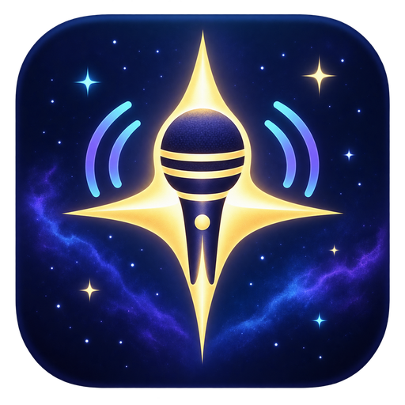
<br>
<sub>Sing together.</sub>
</div>
# Aetherstar

